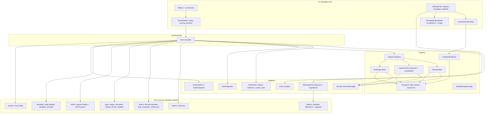
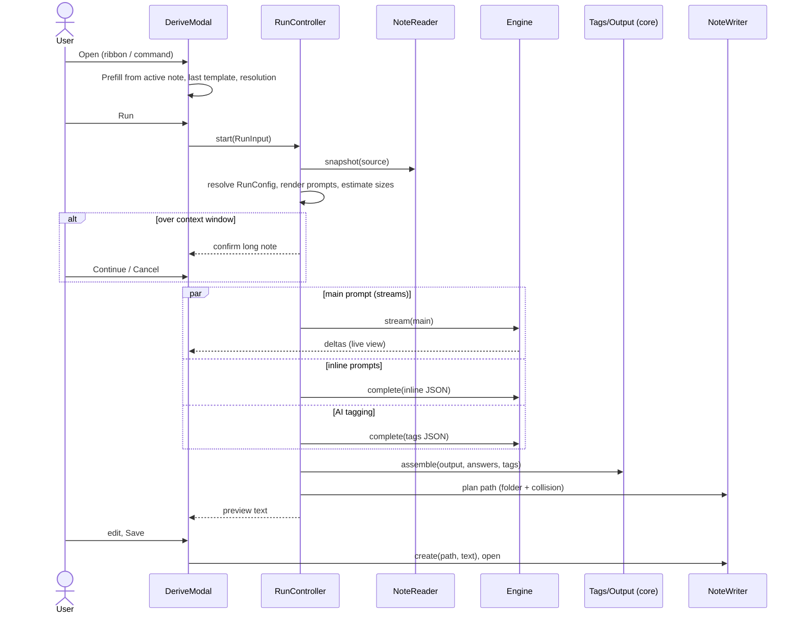
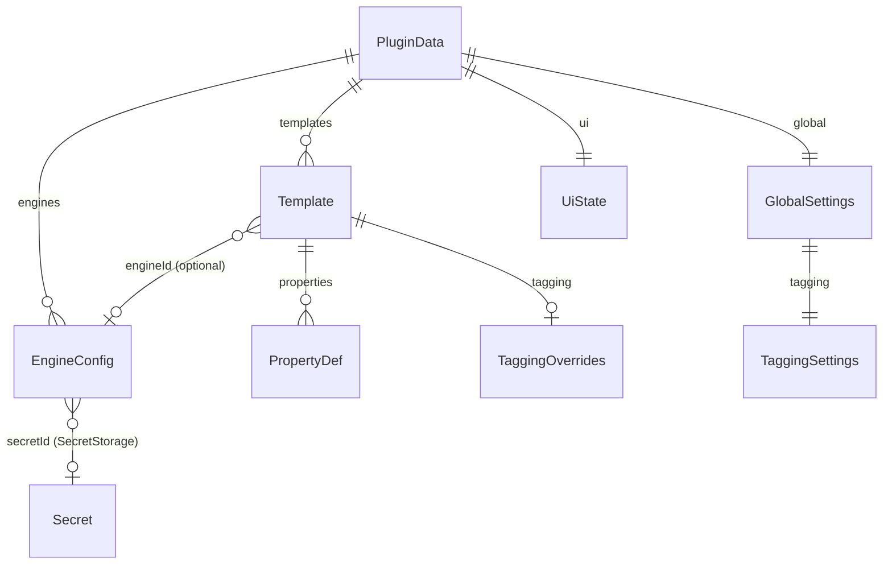

# Obsidian Inference Machine Design

## Summary

The plugin has three layers:

- **A pure core**, with no Obsidian imports, that holds every rule the requirements make testable:
  - settings resolution
  - template rendering through `knap`
  - prompt assembly
  - the tag pipeline
  - output assembly
  - token estimation
- **Adapters** that connect the core to Obsidian (vault, metadata cache, SecretStorage, links) and to AI providers (four engine clients on two transports).
- **A thin UI** of native Obsidian modals and settings built on CodeMirror 6 editors.

A run is orchestrated by a `RunController`:
1. Resolve the run's configuration.
2. Read the source note into a plain `NoteSnapshot`.
3. Check request sizes.
4. Send the main, inline-prompt and AI-tagging requests concurrently.
5. Assemble the output note as text.
6. Show the preview, then save.

Nothing touches the vault until the user saves (or "Skip preview" saves for them).

## Architecture



### Module layout

```
src/
  main.ts                    Plugin: lifecycle, ribbon, command registry, settings load
  core/                      Pure. Unit-tested with Vitest. Never imports 'obsidian'.
    resolve.ts               Settings resolution, producing RunConfig
    template/knap.ts         The only module that imports knap: render, validate, collectPrompts
    template/variables.ts    NoteSnapshot to the variable map
    template/prompt.ts       Main-prompt assembly (5.0.5 auto-append)
    inline.ts                Inline-prompt request text + defensive JSON parser
    tags/                    normalize.ts, pipeline.ts, format.ts, validate.ts
    output.ts                Fence strip, AI-frontmatter split, properties, references, final text
    filename.ts              Sanitize, collision numbering
    tokens.ts                Size estimate
    builtins/                One file per built-in template + shared "Reading the source note" text
    examples/                Example templates (Recipe card, Book reference, Movie reference) as JSON
    schema.ts                PluginData types, template import/export validation
  engines/
    engine.ts                Engine interface, NormalizedError
    transport.ts             fetchStream(), requestJson() over requestUrl, CORS fallback
    sse.ts                   Server-sent-events parser
    anthropic.ts openai.ts gemini.ts
    model-metadata.ts        Known context windows for Anthropic/OpenAI models
    lmstudio.ts              Detection
  obsidian/                  Adapters: note-reader.ts, tag-index.ts, note-writer.ts, links.ts, secrets.ts, settings-store.ts
  run/run-controller.ts
  ui/                        derive-modal.ts, preview-editor.ts, template-editor.ts, settings-tab.ts,
                             suggesters.ts, detect-flow.ts, confirm-modals.ts
```

The dividing line is enforced by an ESLint `no-restricted-imports` rule that bans `obsidian` under `src/core/`. That keeps the requirement-heavy logic testable without Obsidian (12.5, tech.md Testing).

### A run, end to end



## Key design decisions

### 1. The run produces text, and the preview text is what gets saved
`output.ts` assembles the complete note (YAML frontmatter plus body) as a single string. The preview editor holds that string, and saving writes the editor's contents verbatim with `vault.create`.

- **Why:** this makes 9.1 ("exactly as saved") and 9.2 (edits are kept) true by construction. It avoids an internal note model that would have to stay in sync with whatever the user types.
- **Trade-off:** tags the user adds by hand in the preview don't go back through the pipeline. That's acceptable, because the preview is the user's final say.

### 2. Built-in templates live in user data, with their origin recorded
On first load, and after each upgrade, every built-in template is written into `data.json` as an ordinary template carrying `origin: { builtInId, version, hash }`, where `hash` is the hash of its content.

- **Upgrades (15.0.4):** on load, a template is replaced with a newer built-in version only if its current content hash still equals `origin.hash`, meaning it's unedited. Editing a built-in in place changes its hash, so it's never overwritten.
- **Duplicating (15.0.3):** produces a template without `origin`.
- **Restoring:** a deleted built-in can be restored from settings ("Restore built-in templates").
- **Why:** the user sees one list of templates, built-ins can be run unchanged, and the upgrade rule needs no separate "edited" flag that could drift. This follows the YouTube summarizer's `upgradeSavedPrompt`.

### 3. Optional template fields mean "inherit"
Every overridable template field is optional. `undefined` means "use the global config", and the template editor shows it as a tri-state control: *Inherit / On / Off*, or *Inherit / value*.

`resolve.ts` builds a fully populated `RunConfig` by layering:
1. popup overrides
2. the template
3. global settings
4. `DEFAULTS`

It records which layer supplied each field, so the UI can show "from global settings" hints.

- **Why:** this is the requirements' resolution order expressed as plain data merging, which makes it one pure function to test (5.2, 5.3).

### 4. Three independent requests, all sent at once
`RunController` sends up to three requests concurrently:

| Request | When | Transport |
|---|---|---|
| Main prompt | The template has a main prompt | Streaming `fetch` where allowed, else `requestUrl` |
| Inline prompts | The template has `{{"…"}}` variables | `requestUrl`, JSON |
| AI tagging | AI tagging is resolved on | `requestUrl`, JSON |

- **Why:** they don't depend on each other. Inline prompts and tagging read the source note, not the main output (14.0.2, 21.0.2). Running them together makes the wall-clock time about the slowest single request.
- **Partial failure:** a failed inline or tagging request degrades to empty answers or no AI tags, with a notice (14.0.9, 21.0.6). A failed main request fails the run (8.0.6), unless the template has no main prompt.

### 5. Cancellation stops waiting rather than stopping requests
Each run has an `AbortController` and a run token.
- **Streaming `fetch` requests** are aborted directly.
- **`requestUrl` requests** can't be aborted, so on cancel the run token is invalidated and any later result is dropped.

Either way, nothing is written (8.2). The cost is that a cancelled non-streaming request may still finish, and be billed, at the provider.

### 6. Streaming is decided per engine, and failures fall back
`transport.ts` tries `fetch` with streaming. If it fails before any response arrives with a `TypeError`, the browser's signature for a blocked cross-origin request or network failure, the client:
1. retries once through `requestUrl` without streaming
2. adds the engine to a session-scoped `streamingBlocked` set
3. reports a `cors` hint once, for example "Turn on CORS in LM Studio's server settings to get streaming output"

Later runs on that engine go straight to `requestUrl`. An HTTP error response (4xx/5xx) is a real error, never a reason to fall back.

### 7. Tag equivalence is one key function
`normalize.ts` defines `tagKey(tag)`:
1. Strip a leading `#`.
2. Split into words on `/`, `-`, `_`, whitespace, and lower-to-upper case boundaries. Digit-to-letter boundaries are kept together, so `y1984` is one word.
3. Lowercase the words and join them with a single space.

So `ai/machine-learning`, `ai-machine-learning`, `AiMachineLearning` and `ai_machine_learning` all have the key `ai machine learning` (12.0.2, Q3). Dedup, precedence (12.0.3) and existing-vault-tag matching (14.0.3, 14.0.5) all compare keys, which is why every equivalence rule behaves the same everywhere.

### 8. Inline prompts are collected from the template, then resolved during rendering
`template/knap.ts` parses the filename pattern, property values and body wrapper. It walks `knap`'s AST for variable nodes whose name starts with `"` (`knap`'s parser already treats these as prompt variables) and collects their text in order. After the inline request returns, rendering passes a `resolveVariable` callback. `knap`'s `render` takes an async resolver, which maps each prompt's text to its answer, so `knap` applies the variable's own filters (21.0.4). Identical prompt texts share one answer.

### 9. Unknown-variable checks are ours, not `knap`'s
`knap`'s built-in variable checks know Web Clipper's page variables (`url`, `selector:` and so on), not ours. `template/knap.ts` uses `knap`'s `validate` for syntax and filter errors (7.0.3), and walks the AST for unknown variable names against our own catalog (6.0.4, 21.0.7). Both feed CodeMirror lint diagnostics in the template editor.

### 10. Template triggers are parsed once and matched against the snapshot
`core/triggers.ts` parses each trigger line into a typed rule (`tag`, `folder`, `property`, `title`, `content`) or a problem with its line number, and `matchTemplate(templates, note)` returns the first template, in list order, with a matching rule, plus the trigger that matched (REQ-22).

- Matching runs on a `NoteSnapshot`, so it uses the same tags (frontmatter and inline, with 11.0.4's string splitting), properties and text as a run does, and stays pure and unit-testable.
- Tag rules compare by `tagFold`, and also match nested tags under them (`#project` matches `project/beta`, not `projects`). Folder rules compare whole path segments, so `folder:Meet` doesn't match `Meetings/`.
- A line that can't be parsed, or a regular expression that won't compile, becomes a diagnostic in the template editor and is skipped when matching (22.0.6), so one bad line never stops the popup opening.
- The popup reads the snapshot when it opens. `cachedRead` is a local file read, not a network request, so 1.0.5 still holds. The setup step renders at once and applies the match when the read finishes, unless the user has already picked a template.

### 11. Reasoning is removed from responses, and an output limit spent on it is reported
Some local reasoning models write their working into the answer text as `<think>…</think>`. `core/reasoning.ts` `stripReasoning(text)` removes every complete `<think>…</think>` block, everything up to a `</think>` that has no opening tag, and a `<think>` block left unclosed at the end (8.0.8). The run controller applies it to the main output before composing the note, and to the inline prompt and tagging responses before parsing them. The live view during the run still shows the raw stream, so the user can see the model working.

When a response is cut off at the output limit (`ChatResult.truncated`) and has no text left after stripping, the main request fails with an `output-limit` error explaining that the model used its whole output limit before answering, and suggesting a higher maximum output tokens (8.0.9). The inline prompt and tagging notices name the same cause.

With no maximum output tokens set, OpenAI, Gemini and OpenAI-compatible requests carry no output limit, so the provider's or model's default applies. Anthropic, whose API requires `max_tokens`, gets 8,192 (3.0.11).

### 12. LM Studio's loaded context length is read before a run, and set when asked
LM Studio fixes a model's context length when it loads the model, and its OpenAI-compatible endpoint can't change it per request. For engines made by detection (they carry `lmStudio`), `engines/lmstudio.ts` reads the loaded instance from the native `GET /api/v1/models` before each run, with the engine's token:

- The long-note check uses the smaller of the loaded context length and the engine's setting (4.0.9), so the warning reflects what LM Studio will actually accept.
- With `lmStudio.loadContext` on (4.0.10), a model loaded at another length, or not loaded, is unloaded (`POST /api/v1/models/unload`) and loaded with `POST /api/v1/models/load` and `context_length`. The run controller reports a `loading` status, which the popup shows, and loading can take seconds to minutes. A failed load fails the run with LM Studio's message.
- Reading is a quick local request on desktop. Engines not made by detection, and older LM Studio versions without the v1 API, are left as they are: the check falls back to the engine's setting.

## Data model



```ts
interface PluginData {
  schemaVersion: number;              // for settings migrations
  engines: EngineConfig[];
  defaultEngineId?: string;           // 3.0.3
  global: GlobalSettings;
  templates: Template[];
  ui: UiState;
}

type ProviderType = 'anthropic' | 'openai' | 'gemini' | 'openai-compatible';

interface EngineConfig {
  id: string;                         // stable; templates refer to engines by id
  name: string;
  provider: ProviderType;
  baseUrl?: string;                   // required for openai-compatible; override for others
  secretId?: string;                  // SecretStorage id; optional for openai-compatible (3.0.10)
  model: string;
  temperature?: number;
  maxOutputTokens?: number;
  contextWindow?: number;             // 3.0.9
  contextWindowSource?: 'reported' | 'table' | 'user';
  lmStudio?: { port: number; loadContext?: boolean };   // set by detection; used to upsert (4.4); decision 12
}

interface Template {
  id: string;                         // stable; command id is derive-<id> (1.4)
  name: string;
  prompt?: string;                    // main prompt (5.0.2: main and/or inline)
  context?: string;                   // inline prompt context (21.0.3)
  noteNameFormat?: string;            // filename pattern (Web Clipper field name)
  location?: { mode: 'folder'; path: string } | { mode: 'alongside' };
  noteContentFormat?: string;         // body wrapper; uses {{output}}
  properties?: PropertyDef[];
  omitEmptyProperties?: boolean;      // true for built-ins and examples (15.0.8, 20.0.8)
  tagging?: TaggingOverrides;
  engineId?: string;
  skipPreview?: boolean;              // 9.0.4
  references?: { enabled?: boolean; heading?: string };
  openAfterCreate?: boolean;
  origin?: { builtInId: string; version: number; hash: string };   // decision 2
  triggers?: string[];                // REQ-22, one rule per line; decision 10
}

interface PropertyDef {
  name: string;
  value: string;                      // knap template
  type: 'text' | 'multitext' | 'number' | 'checkbox' | 'date' | 'datetime';
}

interface TaggingSettings {
  mergeSourceTags: boolean;           // default true
  aiTagging: boolean;                 // default false
  format: 'kebab' | 'snake' | 'camel' | 'pascal' | { custom: string };
  applyFormatToSource: boolean;       // default false
  hierarchicalPrefixes: boolean;      // default true
  reuseVaultTags: boolean;            // default true
  existingOnly: boolean;              // default false
  minTags: number; maxTags: number;   // default 3, 7
}

interface TaggingOverrides extends Partial<TaggingSettings> {
  preferredTags?: string[];           // 14.0.6, template-only
}

interface GlobalSettings {
  location: Template['location'];
  noteNameFormat?: string;
  tagging: TaggingSettings;
  references: { enabled: boolean; heading: string };   // default true, '# References'
  openAfterCreate: boolean;
  collision: 'number' | 'ask';                          // 10.0.4
  lmStudioPort: number;                                 // default 1234
}

interface UiState { lastTemplateId?: string; lastLocation?: Template['location']; }
```

**Template import/export file (REQ-20):** `{ schemaVersion: "1", plugin: "obsidian-inference-machine", templates: TemplateExport[] }`.
- `TemplateExport` is `Template` without `id` and `origin`, and with `engineId` replaced by `engineName` (20.0.3).
- Import validates required fields (`name`, plus `prompt` or at least one inline prompt) and types. A bad file is rejected whole (20.0.5).
- Each imported template gets a new `id`. A name collision gets `" 1"`, `" 2"` and so on (20.0.4). `engineName` is matched against existing engines, otherwise left unset (20.0.6).

**Variables (REQ-6).** `variables.ts` builds the following map. Exact names are settled here (6.1):

| Variable | Value |
|---|---|
| `{{title}}` | source filename without extension |
| `{{content}}` | full contents, frontmatter included |
| `{{body}}` | contents without frontmatter |
| `{{frontmatter}}` | the raw YAML text of the frontmatter |
| `{{properties.<key>}}`, `{{properties["key with spaces"]}}` | individual frontmatter values |
| `{{path}}`, `{{folder}}` | vault-relative path, parent folder |
| `{{created}}`, `{{modified}}` | the source file's creation and modification times |
| `{{date}}`, `{{time}}` | current date and time (as in Web Clipper) |
| `{{template}}` | the template's name (used in the default filename) |
| `{{output}}` | main AI output body; body wrapper and property values only |
| `{{"…"}}` | inline prompt (REQ-21) |

The built-in default filename pattern is `{{title}} - {{template}}` (5.0.4).

## Interfaces

```ts
// core/resolve.ts
function resolveRunConfig(input: {
  popup: PopupOverrides; template: Template; global: GlobalSettings;
  engines: EngineConfig[]; defaultEngineId?: string;
}): { config: RunConfig; notices: string[] };   // notices: e.g. missing engine (3.0.7)

// core/template/knap.ts
function render(tpl: string, vars: VariableMap, prompts?: Map<string, string>): Promise<string>;
function collectPrompts(tpls: string[]): string[];                  // ordered, de-duplicated
function diagnose(tpl: string, where: 'prompt' | 'context' | 'output'): Diagnostic[];

// core/template/prompt.ts
function buildMainPrompt(rendered: string, note: NoteSnapshot): string;   // 5.0.5 auto-append

// core/inline.ts
function buildInlineRequest(context: string, prompts: string[]): ChatRequest;
function parseInlineResponse(raw: string, count: number): (string | undefined)[];

// core/tags/pipeline.ts
function buildTags(input: {
  sourceFrontmatter: string[]; sourceInline: string[];
  template: string[]; ai: string[]; vaultTags: Set<string>;   // vault tag keys
  settings: TaggingSettings;
}): { tags: string[]; dropped: { tag: string; reason: 'invalid' | 'not-in-vault' }[] };

// core/output.ts
function assembleNote(input: {
  rawOutput?: string; rendered: { body: string; properties: RenderedProperty[] };
  tags: string[]; references?: { heading: string; link: string };
  omitEmpty: boolean;
}): string;
function stripEnclosingFence(s: string): string;                                     // 8.0.5
function splitLeadingFrontmatter(s: string): { data?: Record<string, unknown>; body: string };  // 8.0.7

// core/tokens.ts
function estimateTokens(text: string): number;                    // ceil(chars / 3.5)

// engines/engine.ts
interface Engine {
  stream(req: ChatRequest, onDelta: (t: string) => void, signal: AbortSignal): Promise<ChatResult>;
  complete(req: ChatRequest, opts?: { json?: boolean }): Promise<ChatResult>;
  listModels(): Promise<ModelInfo[]>;              // ModelInfo.contextWindow when reported
  test(): Promise<void>;                           // 3.0.5
}
interface ChatRequest { system?: string; user: string; maxOutputTokens?: number; temperature?: number; }
interface ChatResult { text: string; truncated: boolean; streamed: boolean; }
type ErrorKind = 'auth' | 'rate-limit' | 'network' | 'cors' | 'not-found' | 'context-length'
  | 'provider' | 'empty' | 'cancelled';
class NormalizedError extends Error { kind: ErrorKind; status?: number; hint?: string; }

// engines/lmstudio.ts
type DetectResult =
  | { kind: 'ok'; baseUrl: string; models: ModelInfo[]; loadedModelId?: string }
  | { kind: 'unreachable' } | { kind: 'no-models' } | { kind: 'auth-required' };
function detectLmStudio(port: number, token?: string): Promise<DetectResult>;

// obsidian/ adapters
interface NoteSnapshot { title: string; path: string; folder: string; content: string; body: string;
  frontmatterText: string; properties: Record<string, unknown>;
  frontmatterTags: string[]; inlineTags: string[]; ctime: number; mtime: number; }
function readNote(app: App, file: TFile): Promise<NoteSnapshot>;          // read-only (2.0.4)
interface VaultTagIndex { keys(): Set<string>; ranked(limit: number): string[]; prefixes(): string[]; }
function planPath(app: App, folder: string, name: string): Promise<string>;  // numbering (10.0.4)
```

### Provider wire formats

| Engine | Endpoint | Auth header | Streaming | Max output | Models / context |
|---|---|---|---|---|---|
| Anthropic | `POST {base}/v1/messages` | `x-api-key`, `anthropic-version`, `anthropic-dangerous-direct-browser-access: true` | SSE `content_block_delta` | `max_tokens` (required; 8,192 when unset) | `GET /v1/models`; context window from `model-metadata.ts` |
| OpenAI | `POST {base}/v1/chat/completions` | `Authorization: Bearer` | SSE `choices[].delta` | `max_completion_tokens`, only when set | `GET /v1/models`; context window from table |
| OpenAI-compatible | `POST {baseUrl}/chat/completions` | `Authorization: Bearer` **only if a key is set** (3.0.10) | as OpenAI | `max_tokens` (wider server support), only when set | `GET {baseUrl}/models`; LM Studio adds native metadata |
| Gemini | `POST …/models/{m}:generateContent`, `:streamGenerateContent?alt=sse` | `x-goog-api-key` | SSE | `generationConfig.maxOutputTokens`, only when set | `GET …/models` with `inputTokenLimit` |

Truncation flags (`stop_reason: max_tokens`, `finish_reason: length`, `finishReason: MAX_TOKENS`) set `ChatResult.truncated`, which the preview shows as a warning.

JSON mode (`json: true`):
- OpenAI: `response_format: {type: "json_object"}`
- Gemini: `responseMimeType: "application/json"`
- Anthropic and OpenAI-compatible: by instruction only, with the defensive parser.

## UI design notes

Screen-level visual design is left to `design-direction` if wanted. These are the structural decisions the requirements depend on.

- **DeriveModal** is one `Modal` with three steps, resized with plugin CSS.
- **Setup step:**
  - source note, from a `FuzzySuggestModal` over `vault.getMarkdownFiles()`
  - template dropdown
  - output location (folder suggester, or "next to source")
  - engine dropdown, labelled **Local** or **Remote** (18.0.1)
  - "Run"
  - "Run" stays disabled until there's a source note and an engine. With no engines, the step is replaced by the "configure an engine" panel with a button that opens settings (3.0.8).
- **Running step:**
  - main output streams into a read-only CodeMirror view
  - a spinner per pending request: output, inline prompts, tags
  - "Cancel"
- **Template choice (REQ-22):** a "Derive with" command's template, else the first template whose trigger matches the source note, else the last-used template, else the first. A trigger-chosen template shows "Matched" and the matching trigger, such as `folder:Meetings`, under the dropdown. Changing the source note re-applies triggers until the user picks a template themselves.
- **Preview step:** a full-height editable CodeMirror Markdown editor, plus a strip of warnings: truncated output, dropped tags (13.0.5), unanswered prompts (21.0.6), notices. Its buttons are "Save", "Discard" and "Back" to Setup, which keeps the selections.
- **Modal size:** the modal grows to about 90% of the viewport for the Running and Preview steps (REQ-9). On mobile it's full-screen.
- **Keyboard:** Tab order follows the visual order, `Mod+Enter` runs or saves, and `Esc` cancels or closes (19.0.2).
- **TemplateEditorModal:** CodeMirror fields for main prompt, prompt context, filename, body wrapper and property values, with `knap/codemirror` highlighting and lint diagnostics (6.0.4, 7.0.3, 21.0.7), and a Triggers field, one rule per line, whose unreadable lines and invalid expressions are flagged (22.0.6). Inheritable settings are tri-state controls (decision 3).
- **SettingsTab sections**, declared through `getSettingDefinitions()` so Obsidian's settings search finds them:
  - Engines: list; add/edit with `SecretComponent`; List models; Test; "Detect LM Studio", hidden when `Platform.isMobile` (4.0.6, 17.2)
  - Templates: list, with drag-to-reorder that sets trigger order (22.0.8); new, duplicate, edit, delete; import, export; restore built-ins
  - Output defaults
  - Tagging defaults
  - About: the network-use disclosure (18.0.5)

## Error handling & edge cases

| Situation | Handling | Req |
|---|---|---|
| No Markdown note active, or a PDF/canvas is active | Source left empty; Run disabled | 2.0.3, 2.3 |
| No engines configured | "Configure an engine" panel | 3.0.8, 3.6 |
| Template's engine deleted | `resolveRunConfig` falls back to the default and returns a notice | 3.0.7, 3.5 |
| Invalid API key | 401/403 maps to `auth` with a plain message naming the engine; never the key | 3.4, 18.2 |
| Rate limit / server error / network | `rate-limit` / `provider` / `network`, shown in the Setup step with selections kept, so Run can be retried | 8.0.6, 8.4 |
| Cross-origin block on streaming | Fallback to `requestUrl`, engine marked, one-time hint | decision 6 |
| Main output empty | `empty` error; no note | 8.0.6 |
| Output cut off at the token limit | Note still produced; preview warning | tech.md |
| Output wrapped in one code fence | `stripEnclosingFence` removes it, but only when the whole response is a single fence | 8.0.5, 8.3 |
| Output starts with YAML frontmatter | Split and merged; template properties win; its `tags` count as AI tags | 8.0.7, 8.6, 8.7 |
| Inline request fails or misses keys | Unanswered variables become empty; one notice lists them | 21.0.6, 21.6 |
| Tagging request fails | Note without AI tags; notice | 14.0.9, 14.6 |
| Request larger than the context window | Confirm modal before sending; Cancel sends nothing | 16.0.2, 16.1–16.2 |
| Context window unknown | No warning; engine settings show "can't warn" | 16.0.4, 16.3 |
| Cancel during a run | Abort fetch; drop `requestUrl` results via the run token; nothing written | 8.0.4, 8.2 |
| Output folder missing | `vault.createFolder` for each missing level | 10.0.2 |
| Illegal filename characters | `filename.ts` removes `\ / : * ? " < > \|` and leading dots, trims, falls back to `Untitled` | 10.0.3 |
| Name collision | `planPath` adds ` 1`, ` 2` and so on; with `collision: 'ask'`, a modal offers rename, number or cancel. Re-checked at save, and the source link is regenerated if the path changed | 10.0.4, 10.4 |
| References heading already in output | Link appended inside that heading's section; otherwise the heading is appended at the end | 10.0.6, 10.6 |
| Tag can't be made valid (`1984`) | Dropped; listed in the preview warnings | 13.0.5, 13.4 |
| `tags:` is a string in the source | Split on commas and spaces by `note-reader.ts`; Obsidian's `parseFrontMatterTags` would read `"alpha, beta"` as no tags (Q28) | 11.0.4, 11.4 |
| AI returns more than `maxTags` | AI tags capped after dedup against source and template tags | 14.0.4, 14.2 |
| Inline prompt in the main prompt or context | Lint error in the editor; literal text at run time | 21.0.7, 21.7 |
| Malformed import file | Rejected whole with a reason; no change | 20.0.5, 20.4 |
| Reasoning in a response (`<think>…</think>`) | `stripReasoning` removes it before the note is composed or answers are parsed | 8.0.8, 8.8 |
| Output limit spent before any answer | `output-limit` error (main) or notice (inline, tagging) suggesting a higher maximum output tokens | 8.0.9, 8.9 |
| Invalid trigger line or regular expression | Flagged in the template editor; skipped when matching | 22.0.6, 22.8 |
| Plugin data from an older version | `settings-store.ts` migrates by `schemaVersion`, then upgrades unedited built-ins | 15.0.4 |
| A template is renamed or deleted | `removeCommand` and re-`addCommand` for `derive-<id>` | 1.0.4, 1.4 |

**Tag pipeline order** (`pipeline.ts`):
1. Collect the candidate lists. Source tags are included only if `mergeSourceTags` is on.
2. Prepare the AI tags:
   - drop any not in the vault when `existingOnly` is on
   - flatten `/` when `hierarchicalPrefixes` is off
   - convert to the format unless the tag matches a vault tag key, in which case use the vault's spelling
3. If `applyFormatToSource` is on, format the source and template tags.
4. Make every tag valid; record dropped tags.
5. Deduplicate by `tagKey`, keeping the spelling with the highest precedence: source frontmatter > source inline > template > reused vault tag > nested AI > flat AI.
6. Order: source frontmatter, source inline, template, then AI.
7. Cap the AI-contributed tags at `maxTags`.

**References insertion** (`output.ts`):
1. Match the configured heading as a whole line (ignoring trailing spaces) outside code fences.
2. If found, insert `- <link>` at the end of that heading's section, before the next heading of the same or higher level.
3. Otherwise append `\n\n<heading>\n- <link>` at the end.
4. The link comes from `generateMarkdownLink(source, plannedPath)` (Q16).

**Secret redaction:** `NormalizedError` messages are built from status codes and provider error bodies. Before display, any occurrence of the engine's secret value is replaced with `***` (18.0.3).

## Traceability

| Requirement | Satisfied by |
|---|---|
| REQ-1 Entry points | `main.ts` ribbon + `derive-<id>` command registry (decision 2 ids; rename/delete re-registration); DeriveModal opens from local state only (1.5) |
| REQ-2 Source selection | DeriveModal prefill from `workspace.getActiveFile()` if `.md`; FuzzySuggestModal; `NoteReader` is read-only, and no write path takes the source file (2.4) |
| REQ-3 Engines | `EngineConfig`, SettingsTab Engines, `Engine` clients, `resolve.ts` (3.0.6–3.0.7), `NormalizedError`, OpenAI-compatible optional Bearer (3.8), output limit only when set (decision 11, 3.9) |
| REQ-4 LM Studio | Loaded context length read before a run and shown in settings, and optional load with the engine's context window (decision 12, 4.0.9–4.0.10); `lmstudio.ts` `DetectResult` states; detect flow modals: model choice, token prompt (4.5–4.6); upsert by `lmStudio.port` (4.4); hidden on mobile |
| REQ-5 Templates | `Template` schema, tri-state inheritance, `resolve.ts`, `DEFAULTS`, `buildMainPrompt` auto-append (5.4), default filename (5.5) |
| REQ-6 Variables | `variables.ts` table above; `diagnose` unknown names (6.4) |
| REQ-7 Filters | `knap` `standardFilters` (7.1 parity by construction); `validate` diagnostics; run-time notice for invalid filters |
| REQ-8 Running | `RunController`, concurrent requests, streaming transport, cancel (decision 5), `stripEnclosingFence`, `splitLeadingFrontmatter`, `stripReasoning` and the `output-limit` error (decision 11) |
| REQ-9 Preview | DeriveModal Preview step; text-as-saved (decision 1); `skipPreview` |
| REQ-10 Output | `planPath`, `filename.ts`, folder creation, references insertion, `openAfterCreate` |
| REQ-11 Merging | `NoteSnapshot.frontmatterTags` / `inlineTags`; pipeline steps 1, 6 |
| REQ-12 Dedup | `tagKey` (decision 7); precedence in step 5; 12.5 property-based tests over random tag mixes |
| REQ-13 Formats | `format.ts` per-segment conversion; `validate.ts`; `applyFormatToSource` |
| REQ-14 AI tagging | Tagging request (vault tags ranked and capped at 1,000, prefixes, preferred tags, format instruction, count range); `VaultTagIndex` built lazily only when AI tagging is on (14.1); pipeline step 2 |
| REQ-15 Built-ins | `core/builtins/*` with shared "Reading the source note" text; origin hash upgrade (decision 2); Literature note properties `source`/`author`/`published` + `created: {{date}}` on all; `omitEmptyProperties` |
| REQ-16 Long notes | `tokens.ts` against `contextWindow - maxOutputTokens`, for both main and inline requests; confirm modal |
| REQ-17 Mobile | No Node APIs (lint); `Platform.isMobile` gating; full-screen modal; `requestUrl` fallback |
| REQ-18 Privacy | Local/Remote label from base-URL host (loopback or private ranges count as local); SecretStorage only; redaction; README + About disclosure |
| REQ-19 Usability | Native components; keyboard map; `UiState` last template and location |
| REQ-20 Import/export | Export schema without credentials; validated import; `core/examples/*.json` (Recipe card, Book reference, Movie reference) with "leave empty rather than guess" prompts and `omitEmptyProperties` |
| REQ-22 Template triggers | `core/triggers.ts` parse and `matchTemplate` (decision 10); `Template.triggers`, exported and imported with the template; DeriveModal template choice and "Matched" hint; Triggers field with diagnostics; reorderable template list |
| REQ-21 Inline prompts | `collectPrompts` (decision 8), `buildInlineRequest` / `parseInlineResponse`, `context` field default `{{title}}\n\n{{content}}`, async resolver rendering, `diagnose` for misplaced prompts |

**Coverage check:** every acceptance criterion maps to a row above. Two need care at implementation time rather than further design:
- **15.2 and 20.5–20.6** depend on model behavior (sections present, properties left empty). They're tested with fixture engines that return recorded responses, plus a manual check against real models before release.
- **7.1** depends on `knap` matching Web Clipper. That's true by construction while both use the same `knap` version. The test pins shared fixtures from `knap`'s compatibility suite.
